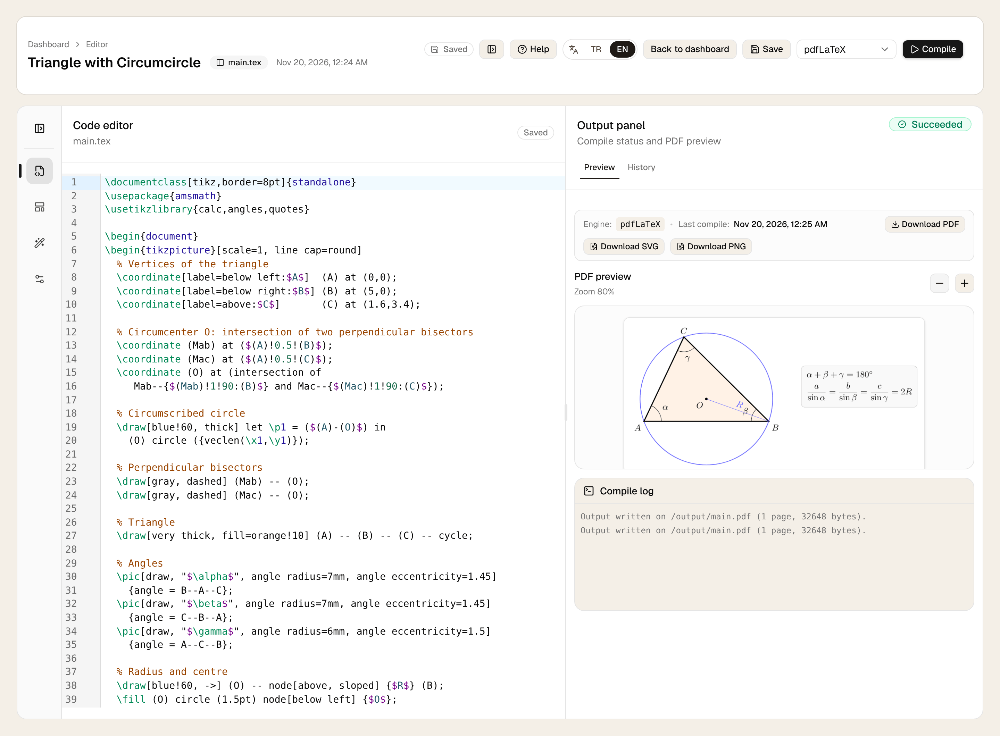
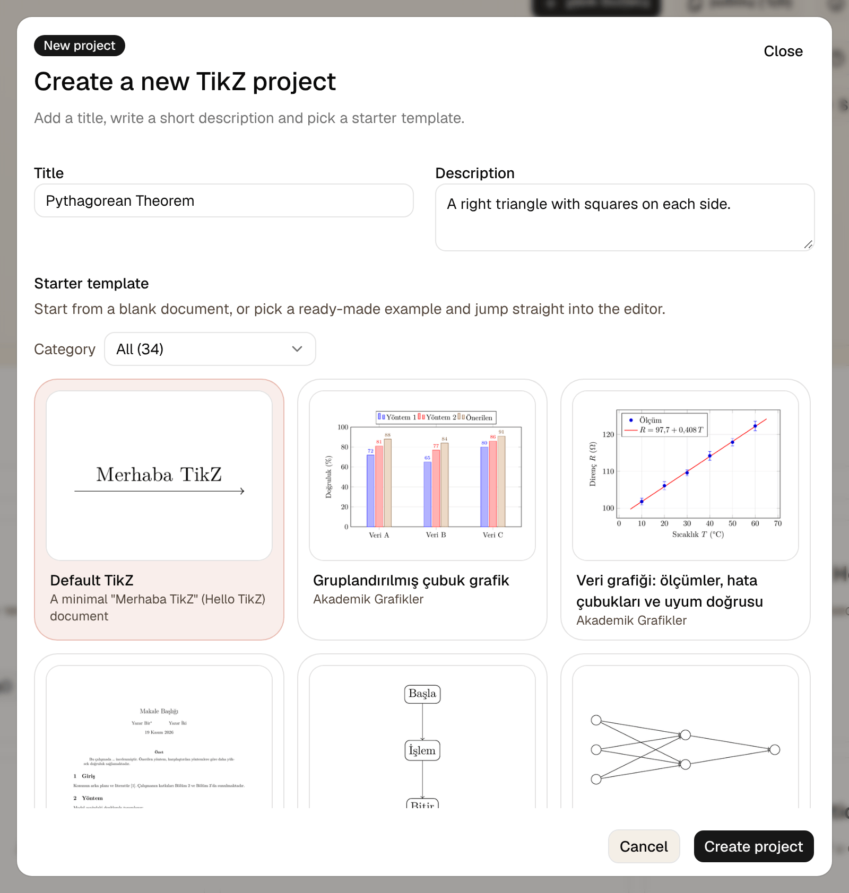
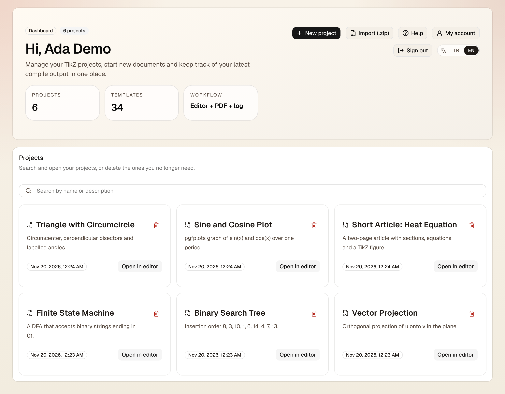
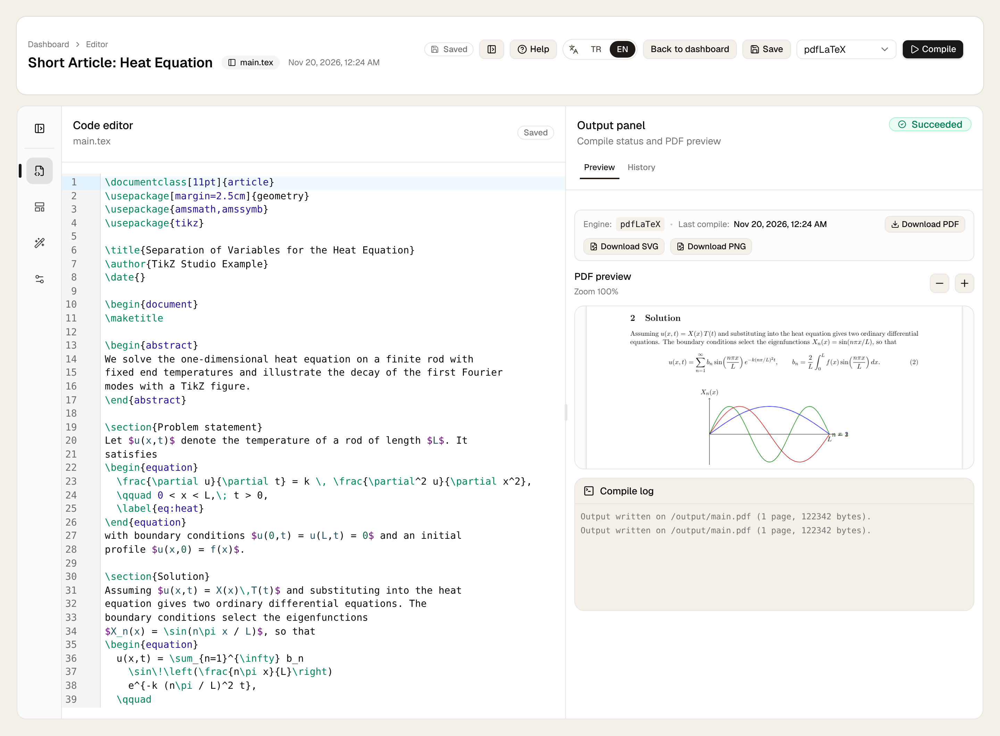
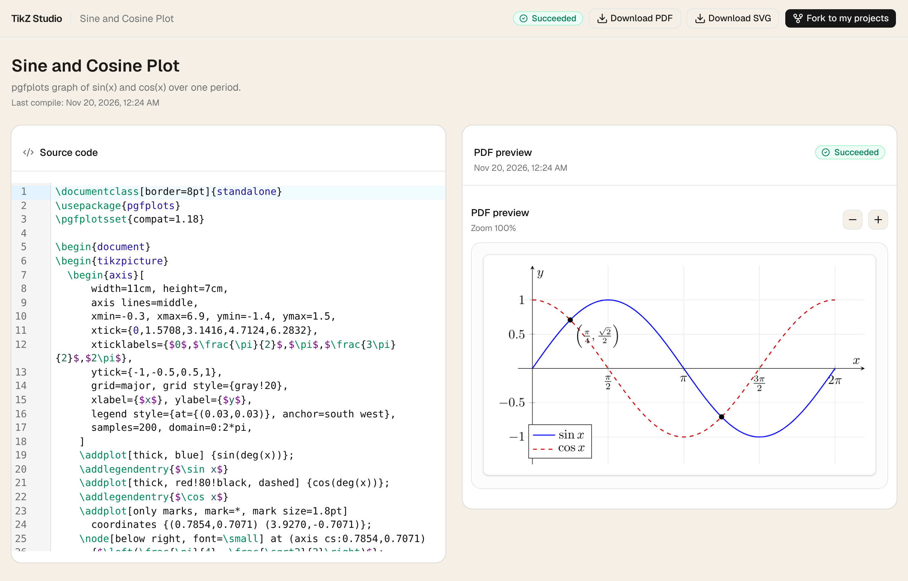
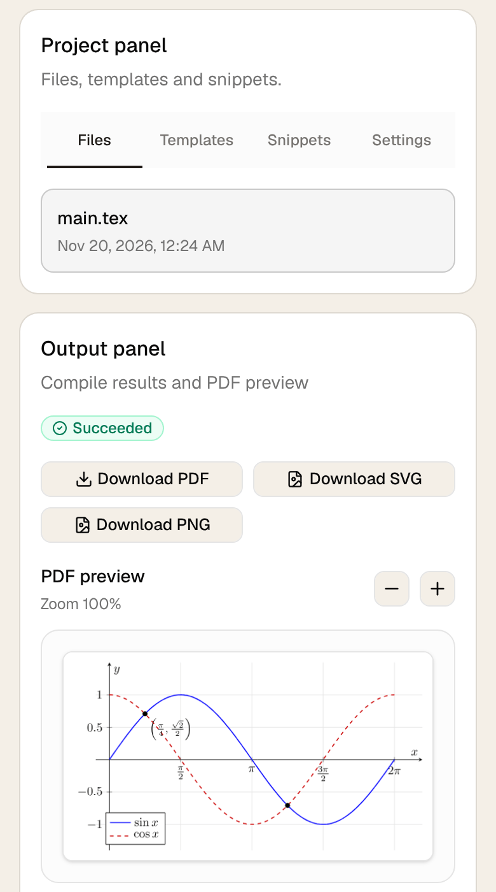

# TikZ Studio

**An online TikZ and LaTeX editor. Write code, compile it in a sandbox, and see the PDF side by side, all in the browser.**

[**Open the app → tikz.futurego.tech**](https://tikz.futurego.tech) · [Product site](https://yucel-yilmaz.github.io/tikzstudio/) · [Türkçe README](README.tr.md)



TikZ Studio pairs a CodeMirror editor with a live PDF preview and a hardened Docker compiler (Tectonic, pdfLaTeX, XeLaTeX, LuaLaTeX, pdfLaTeX + Biber). It is built for anyone who writes TikZ/LaTeX: high-school and university students, teachers, and academics. Nothing needs to be installed on the user's machine.

> **Language:** the interface and API error messages are available in Turkish and English, with a TR/EN switcher in the header (the first visit follows the browser language). The official template and snippet names are still in Turkish. Documents can be written in any language; the screenshots below show the English interface with English example projects.
>
> **Status:** under active development. APIs and UI may change.

---

## ✨ Features

### Writing and compiling

- 📝 **CodeMirror 6 editor** with LaTeX syntax highlighting, bracket matching, line numbers, inline error markers, and auto-save about a second after you stop typing
- ⚙️ **Five LaTeX engines** selectable per project: Tectonic, pdfLaTeX, XeLaTeX, LuaLaTeX, pdfLaTeX + Biber
- 🛡️ **Sandboxed compilation** in a hardened Docker container (`--network none`, `--read-only`, capability drops, memory/CPU/timeout caps, process-level timeout)
- 📄 **Live PDF preview** rendered with PDF.js, DPR-aware for high-DPI displays, with zoom and a summarised compile log
- 🎨 **SVG + PNG export** alongside PDF: SVG is DOMPurify-sanitised; PNG is rendered at 300 DPI via `pdftoppm` (print-ready for worksheets)
- 📚 **Compile history**: browse past jobs and download archived PDF/SVG/PNG outputs
- 🖼️ **Image to LaTeX** (img2latex): convert formula images via Docker Model Runner (`ai/qwen3-vl`), pix2tex (local Docker API) or Mathpix; only configured providers are shown

### Projects, templates and sharing

- 🗂️ **Multi-file projects**: create, rename, delete, upload binaries (images, fonts, `.cls`, `.sty`), mark as main
- 📚 **34 official templates**, Turkish-labelled, multi-file where useful, verified against Tectonic and pdfLaTeX:
  - **Tutorial:** a guided first TikZ drawing
  - **Basics:** shapes, nodes, flowcharts, trees, graphs, a simple neural network
  - **High-school math:** triangles, circles, tkz-euclide, line/parabola/piecewise graphs, unit circle, number line, Venn, probability tree, solids, area between curves, A–E exam sheet
  - **University & academic:** data plot with error bars and fit, grouped bar chart, normal distribution, 3D surface, vectors/projection, commutative diagrams (tikz-cd), finite automaton, control-system block diagram, Beamer slides, multi-file article skeleton
- 🖼️ **Template previews**: every template shows a thumbnail in the new-project dialog (with a category filter) and the templates panel; personal templates get one from the project's latest successful compile
- 🧩 **Snippets with triggers**: insert common TikZ blocks from a panel or by typing `\trigger`; add your own snippets and single-file templates
- 💾 **Save as template**: turn any project (all files) into a personal template from the project settings panel
- 📦 **ZIP import/export (Overleaf-compatible)**: a single top folder is unwrapped, build artifacts are skipped, the main file is detected. Limits: 20 MB archive, 300 files, 5 MB per file
- 🔁 **Public sharing and forking**: a public project gets a read-only page; anyone can copy it into their own workspace

### Accounts and help

- 🔐 **Authentication** via [better-auth](https://www.better-auth.com/): email + password; GitHub and Google OAuth are enabled automatically when their client id/secret are set
- 🛡️ **Account security**: password reset by email (1-hour single-use links, other sessions revoked, change notice), email verification (required automatically once SMTP is configured), an account page (change password, sign out other sessions, delete account) and per-IP rate limits on sign-in/sign-up/email endpoints. Configure SMTP via `SMTP_*`/`MAIL_FROM`; without it emails are logged to the server console
- 🚦 **Rate limiting**: 5 compiles per minute per user (database-backed, no extra dependencies)
- ❓ **Help center and onboarding tour**: articles on engines, outputs, templates, sharing, Turkish documents and troubleshooting, plus a first-visit tour of the screen
- 🌗 **Light/dark theme** support (Tailwind v4)
- 🌐 **Turkish and English UI**: switch languages with the TR/EN toggle; Turkish babel and fonts work in every engine, including Turkish characters in file names

---

## 📸 Screenshots

| Template gallery | Dashboard |
| --- | --- |
|  |  |

**Full LaTeX documents**: an article with sections, numbered equations and an embedded TikZ plot, compiled with pdfLaTeX.



**Public share page**: read-only source and preview, with a button to fork the project into your own account.



**On a phone**, the panels stack vertically, with tabs for files, templates, snippets and settings:



---

## 🌐 Product site

The English product site lives in [`site/`](site/) as plain static HTML/CSS (no build step, no third-party scripts) and is deployed to **https://yucel-yilmaz.github.io/tikzstudio/** by [`.github/workflows/pages.yml`](.github/workflows/pages.yml) on every push to `master` that touches `site/**`. To preview it locally, open `site/index.html` in a browser.

---

## 🧱 Tech Stack

| Layer | Choice |
| --- | --- |
| Framework | Next.js 16 (App Router) + React 19 |
| Language | TypeScript |
| Styling | Tailwind CSS v4 + shadcn/ui (radix-ui) |
| State | TanStack Query, Zustand |
| Editor | CodeMirror 6 (`@uiw/react-codemirror`) |
| Database | PostgreSQL via Prisma 7 |
| Auth | better-auth (email + GitHub + Google OAuth) |
| Job queue | pg-boss (PostgreSQL-backed, no Redis required) |
| LaTeX engines | Tectonic, pdfLaTeX, XeLaTeX, LuaLaTeX, pdfLaTeX+Biber |
| PDF render | PDF.js (legacy build) |
| PDF → SVG | `pdf2svg` (DOMPurify-sanitised) |
| PDF → PNG | `pdftoppm` (poppler-utils, 300 DPI) |
| SVG sanitiser | DOMPurify + jsdom (server-side) |
| Template bundles | JSZip |
| Tests | Vitest |
| Lint/Format | Biome |

---

## 📐 Architecture

```text
                   ┌────────────────────────┐
   browser ─────▶  │  Next.js (App Router)  │  ─── better-auth ──▶  PostgreSQL
                   │  ─ /api/projects/...   │
                   │  ─ /api/compile-jobs/. │  ─── Prisma ──────▶
                   │  ─ /api/templates/...  │
                   │  ─ /api/img2latex      │
                   └──────────┬─────────────┘
                              │ POST /api/projects/:id/compile
                              ▼
                   ┌────────────────────────┐
                   │   pg-boss job queue    │  (stored in PostgreSQL)
                   └──────────┬─────────────┘
                              │ worker picks up job
                              ▼
                   ┌────────────────────────┐
                   │ DockerCompilerAdapter  │
                   │  spawn `docker run`    │
                   │  --network none        │
                   │  --read-only           │
                   │  --cap-drop ALL        │
                   └──────────┬─────────────┘
                              ▼
                   ┌────────────────────────┐
                   │  tikzlab-compiler:*    │
                   │  tectonic / pdflatex   │
                   │  xelatex / lualatex    │
                   │  pdflatex + biber      │
                   │  pdf2svg / pdftoppm    │
                   └────────────────────────┘
                              ▼
              PDF + SVG + PNG ──▶ COMPILE_STORAGE_DIR
              SVG ────────────▶  DOMPurify sanitiser ──▶ browser
```

---

## 🚀 Getting Started

### Prerequisites

- **Node.js** 20+
- **Docker** (for the compile sandbox and the development database)

### Option A — One command (Docker Compose)

```bash
cp .env.example .env
# Edit .env: set BETTER_AUTH_SECRET (and optionally OAuth keys)
docker compose build compiler   # LaTeX sandbox image, 10–20 min the first time
docker compose up --build -d
```

This starts PostgreSQL, applies migrations, seeds the official templates (idempotent) and serves the app at [http://localhost:3000](http://localhost:3000).

The app container starts compile containers through the host Docker daemon (`/var/run/docker.sock` is mounted). Because bind-mount paths are resolved on the host, the compile scratch directory `COMPILE_WORK_DIR` (default `/tmp/tikzstudio-work`) is mounted at the same path inside the container — keep the two in sync if you change it.

### Production — Coolify

Prebuilt images are published to ghcr.io on every merge to `master` (`.github/workflows/release.yml`), and `docker-compose.coolify.yml` deploys them on Coolify (e.g. a Hostinger VPS). Step-by-step guide (Turkish): [docs/deploy-coolify.md](docs/deploy-coolify.md).

### Option B — Manual setup

#### 1. Install dependencies

```bash
npm install
```

#### 2. Configure environment

```bash
cp .env.example .env
# Edit .env — generate a fresh BETTER_AUTH_SECRET:
node -e "console.log(require('crypto').randomBytes(32).toString('base64url'))"
```

#### 3. Start the database

```bash
docker run -d \
  --name tikzlab-postgres \
  -e POSTGRES_USER=postgres \
  -e POSTGRES_PASSWORD=postgres \
  -e POSTGRES_DB=tikzlab \
  -p 5432:5432 \
  -v tikzlab-pgdata:/var/lib/postgresql/data \
  postgres:16-alpine
```

To start it again after a reboot:

```bash
docker start tikzlab-postgres
```

#### 4. Apply migrations and seed

```bash
npm run db:generate    # generate Prisma client
npm run db:migrate     # apply all migrations
npm run db:seed        # seed templates/snippets (optional)
```

#### 5. Build the compiler image

Builds a hardened image with Tectonic, pdfLaTeX, XeLaTeX, LuaLaTeX, Biber, pdf2svg, and pdftoppm. First build takes 10–20 minutes (Rust compile + TeX Live download).

```bash
npm run compiler:build
```

> **If the build fails with "couldn't get bundle from internet"** — see the Troubleshooting section below.

#### 6. Run the dev server

```bash
npm run dev
```

Open [http://localhost:3000](http://localhost:3000) and sign up.

---

## 📜 Available Scripts

| Script                    | What it does                                       |
| ------------------------- | -------------------------------------------------- |
| `npm run dev`             | Start Next.js dev server (Turbopack)               |
| `npm run build`           | Production build + type-check                      |
| `npm run start`           | Run the production build                           |
| `npm run lint`            | Biome check (lint + organize imports + format)     |
| `npm run format`          | Biome format with auto-fix                         |
| `npm run test`            | Run Vitest test suite (single run)                 |
| `npm run test:watch`      | Run Vitest in watch mode                           |
| `npm run db:generate`     | Generate Prisma client                             |
| `npm run db:migrate`      | Apply Prisma migrations (`prisma migrate dev`)     |
| `npm run db:seed`         | Seed the database with templates and snippets      |
| `npm run compiler:build`  | Build the Docker compiler image                    |
| `npm run templates:verify` | Compile every official template in the sandbox (Tectonic + pdfLaTeX) |
| `npm run templates:previews` | Render 480×360 preview images of the official templates into `public/template-previews/` |
| `npm run warmup:sync` | Write official templates to `docker/compiler/warmup-templates/` so the compiler image caches their packages (rebuild the image afterwards) |

---

## 📁 Repository Layout

```text
app/                  Next.js App Router routes (UI + API handlers)
  api/                REST endpoints (projects, files, compile jobs, templates, img2latex, auth)
  (app)/              Authenticated routes (dashboard, editor)
  (marketing)/        Public marketing pages
features/             Feature modules (auth, dashboard, editor, help, share)
  editor/components/  Editor UI: code-editor, pdf-preview, layouts
  editor/store/       Zustand stores
components/           Shared UI primitives (shadcn/ui, ErrorBoundary)
lib/                  Helpers (client API, types, env, compile-log, utils)
server/               Server-side logic
  compiler/           Docker adapter, log parser, SVG sanitiser, storage
  jobs/               pg-boss workers (compile, cleanup)
  services/           Business logic (projects, files, compile jobs, templates)
  schemas/            Zod request schemas
prisma/               Schema, migrations, seed
docker/compiler/      Dockerfile + warmup docs + compile.sh for the sandbox
site/                 Static English product site (GitHub Pages)
tests/                Vitest unit tests
```

---

## 🔒 Security Model

### Compile sandbox

Each compile request runs in an isolated container:

```shell
docker run --rm
  --network none                 # no outbound traffic
  --read-only                    # filesystem is read-only
  --tmpfs /tmp:rw,noexec,nosuid,size=64m
  --memory 256m --cpus 0.5       # resource caps (configurable via env)
  --pids-limit 64
  --security-opt no-new-privileges
  --cap-drop ALL
  tikzlab-compiler:latest
```

Single-pass engines (Tectonic, pdfLaTeX, XeLaTeX, LuaLaTeX) time out at 12 s per process. The pdfLaTeX + Biber pipeline runs four sequential passes and gets a 10× timeout budget.

### SVG output

`pdf2svg` output is piped through a server-side DOMPurify sanitiser before it reaches the browser, blocking `<script>` tags, event handlers, and other XSS vectors.

### Rate limiting

The compile endpoint enforces a 5-per-minute limit per user, checked against the database — no extra infrastructure required.

### Additional limits

- Source bundle is size-capped (`MAX_SOURCE_SIZE_KB`, default 512 KB)
- Output is size-capped (`MAX_OUTPUT_SIZE_MB`, default 10 MB)
- Stale RUNNING/PENDING jobs are recovered to FAILED on server restart
- Compile artifacts are pruned hourly; only the latest successful output per project is kept on disk

---

## 🛠️ Troubleshooting

### PostgreSQL connection refused (P1001 / ECONNREFUSED)

```bash
docker start tikzlab-postgres
```

If you haven't created the container yet, follow step 3 in Getting Started.

### Docker build fails with "couldn't get bundle from internet"

```bash
# Try explicit DNS
docker build --dns=8.8.8.8 --dns=1.1.1.1 \
  -t tikzlab-compiler:latest -f docker/compiler/Dockerfile .

# Or fix Docker Desktop DNS:
# Settings → Resources → Network → DNS Server → 8.8.8.8
```

### Compile fails with "I did not find the tikz library 'X'"

The library isn't in the warmed Tectonic cache (`--only-cached` is on). Add it to `\usetikzlibrary{...}` in [`docker/compiler/warmup.tex`](docker/compiler/warmup.tex), then rebuild:

```bash
npm run compiler:build
```

### pdfLaTeX fails with "File 'package.sty' not found"

The package isn't installed in the TeX Live layer of the compiler image. Add the appropriate `texlive-*` Debian package to the `RUN apt-get install` block in [`docker/compiler/Dockerfile`](docker/compiler/Dockerfile) and rebuild.

### pdfLaTeX + Biber: bibliography not resolved

Biber requires a `.bcf` file produced by a first pdfLaTeX pass. The pipeline handles this automatically. If references still appear as `[?]`, ensure your document uses `\usepackage[backend=biber]{biblatex}` — **not** `bibtex`.

### PDF preview shows a grey box

Stale browser cache for `pdf.worker.min.mjs`. Hard refresh (Ctrl+Shift+R). If still broken, open DevTools → Console and check for PDF.js errors.

### Prisma error: "column ... does not exist"

```bash
npm run db:migrate
```

---

## 🗺️ Roadmap

- [x] Multi-engine UI (pdfLaTeX, XeLaTeX, LuaLaTeX, pdfLaTeX+Biber selectable per compile)
- [x] PNG export
- [x] OAuth providers (GitHub, Google) — opt-in via env
- [x] docker-compose.yml for one-command local setup
- [x] Multi-file template system
- [x] Template library: high-school math and university/academic packs (Turkish)
- [x] Help center and onboarding tour
- [x] English product site (GitHub Pages)
- [x] Project ZIP import/export (Overleaf-compatible) and template previews
- [x] Save project as template (project settings panel; unsaved edits are saved first)
- [x] Turkish UI
- [x] Multi-language UI: Turkish and English with a TR/EN switcher
- [ ] English names for the official templates and snippets
- [x] Image to LaTeX (img2latex) with multiple provider support
- [ ] Real-time collaboration (Y.js)
- [ ] Mobile-first editor improvements

---

## 🤝 Contributing

This is currently a personal project. If you spot a bug or want to suggest a feature, open an issue. Pull requests are welcome but please discuss large changes first.

Before submitting:

```bash
npm run lint
npm run test
```

---

## 📝 License

All rights reserved. No license is granted. The source is published for transparency / portfolio purposes only — please do not redistribute, fork commercially, or deploy without permission.

If you want to use this code, get in touch.

---

## 🙏 Acknowledgements

- [Tectonic](https://tectonic-typesetting.github.io/) — modern LaTeX engine
- [PDF.js](https://mozilla.github.io/pdf.js/) — Mozilla's PDF renderer
- [shadcn/ui](https://ui.shadcn.com/) — UI primitives
- [better-auth](https://www.better-auth.com/) — authentication
- [pdf2svg](https://github.com/dawbarton/pdf2svg) — PDF → SVG conversion
- [pg-boss](https://github.com/timgit/pg-boss) — PostgreSQL-backed job queue
- [DOMPurify](https://github.com/cure53/DOMPurify) — SVG/HTML sanitisation
- [pix2tex](https://github.com/lukas-blecher/LaTeX-OCR) — image to LaTeX OCR
- [poppler-utils](https://poppler.freedesktop.org/) — PDF → PNG conversion
